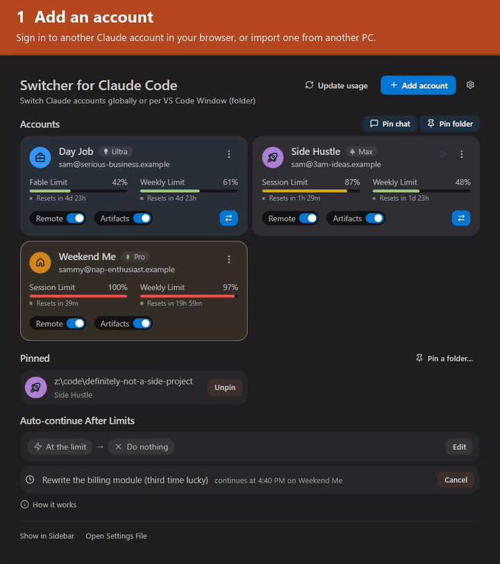
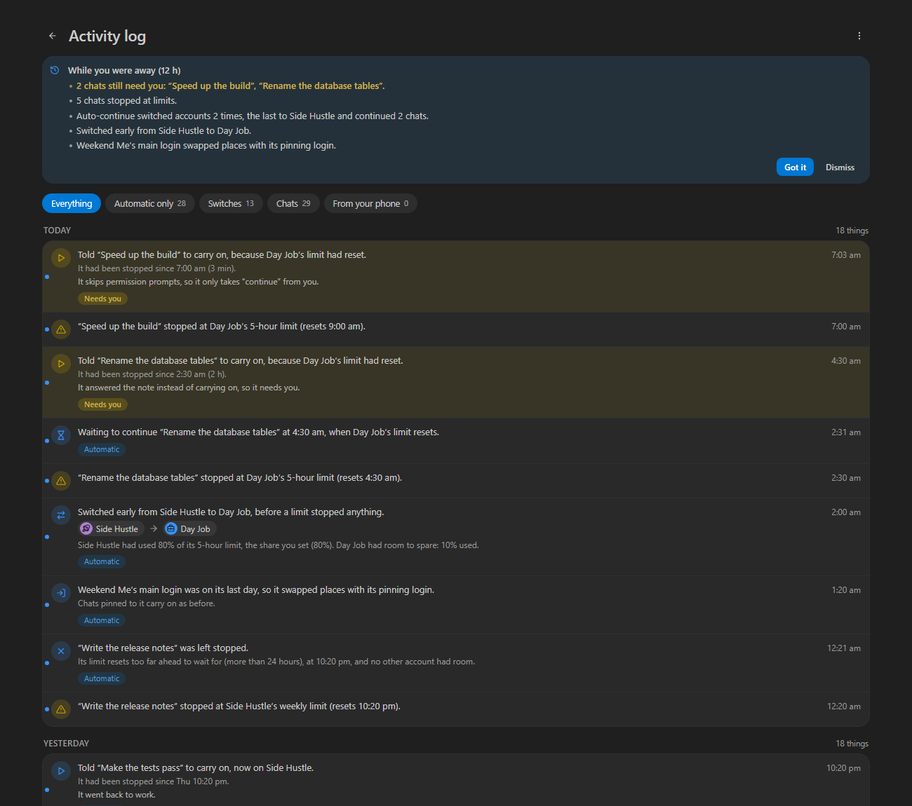

# Switcher for Claude Code [Unofficial]

**Your AI, always ready: more accounts, fewer interruptions.**

**A Claude Code account switcher for VS Code.** Use multiple Claude accounts
(Pro, Max, Ultra, Team) and switch between them in one click, without going
through the browser login every time. See every account's 5-hour and weekly
usage limits at a glance, keep chats going automatically when one account hits
its limit, and pin a folder or a single chat to its own account.

## What's new

**1.5.4**

- **An activity log.** Every account switch and why, the chats that hit a limit,
  what auto-continue did, and messages sent from your phone. After you have been
  away for 30 minutes or more, a **While you were away** note says what happened.
  See [The activity log](#the-activity-log).
- **Open chat.** An entry about a chat has a button that opens it in the editor.
- **Clearer team plan names:** Team Pro and Team Standard.
- **A phone button,** Coming soon, beside the settings gear.
- Every notice has its buttons under its text, and the sign-in reminder on an
  account card sits at the bottom of the card with the usage notes.

**1.5.3 to 1.5.0**

- **Auto-continue is more careful.** It reads reset times in the time zone the
  notice shows, asks about a chat that stopped a while ago instead of acting on
  its own, no longer switches for nothing, and says which chat it switched for.
  With **Do nothing**, a waiting chat is left alone and you get one note.
- **Pop-ups blur the page behind them.**
- **Tells you when a newer version is out,** and says what is new after you
  update.
- **A list view,** with search, filter, sort, groups by organisation and your
  own drag-and-drop order.
- **Usage says how old it is,** with near-limit colours, **extra usage**,
  **use-it-or-lose-it** notes, and a **Has room again** note with **Switch**.
- **Unpinning a chat asks first and reopens it** on your active account.
- **Artifacts off now stops all publishing to claude.ai.**

Earlier versions: see the [Changelog](CHANGELOG.md).

Coming soon: use your chats from your phone with Awaydesk.

## Visuals

**Add an account, switch in one click, and keep chats going at 80%:**



**See every switch and why, and what happened while you were away:**



## Enjoying it?

If Switcher for Claude Code saves you time, please
[give it ★★★★★ on the Marketplace](https://marketplace.visualstudio.com/items?itemName=clumsyboss.account-switcher-claude-code&ssr=false#review-details).
It's the best way to help other Claude Code users find it. Found a problem or
have an idea? [Open an issue](https://github.com/clumsyboss/switcher-for-claude-code/issues).

## Keep it up to date

This is an active project, with new features arriving regularly: auto-continue
after limits, Keep alive and plan detection all came in the last few weeks. Make
sure **Auto Update** is on (Extensions view → Switcher for Claude Code → ⚙ →
**Auto Update**), so you get each one as soon as it's out.

### Checking for updates

A copy installed from a downloaded `.vsix` file usually does not update by
itself, so the Switcher tells you when a newer version is out:

- **What it asks.** Once a day for the whole PC (not per window or editor), it
  asks GitHub for the latest release of this project's public repository. The
  answer is kept in `~/.claude-switcher/updates.json`, so other windows and
  editors read it instead of asking again.
- **What it sends.** Nothing about you: no account, no email, no id, only the
  ordinary request with the name `switcher-for-claude-code`. Like any website
  you visit, GitHub sees your internet address and the time.
- **What it shows.** When a newer version has been out for a day (or right away
  if the editor won't update the Switcher by itself), a notice at the top of
  the Accounts page with **Update**, **What's new** and **Later**, and a small
  mark on the status bar's account item. **Later** keeps quiet about that
  version for 7 days; a different version shows at once. **Update** asks the
  editor to install the version from its own extension store, in place of the
  copy you have (also one installed from a `.vsix` file); the editor then asks
  to restart extensions. If the editor has already downloaded the new version
  and only needs its extensions restarted, the page shows just one quiet line:
  "Restart extensions to finish updating to X."
- **Turning it off.** Switch off **Check for Updates** in Settings
  (`claudeswitcher.checkForUpdates`). The setting belongs to each editor: off
  in one editor stops that editor asking and showing, while another editor on
  the same PC with it on still asks once a day.

After an update, the Accounts page says once what's new in that version, with **See all
changes** for the full changelog.

### The phone button

Next to the settings gear is a phone button. Its pop-up says what phone access
gives you (see your chats and answer Claude from your phone) and has one action,
which depends on **Awaydesk**, a separate extension that does the phone's work:

- **Awaydesk is installed:** **Connect a phone** starts its connecting.
- **Not installed, on Windows, and Awaydesk is in this editor's extension
  store:** **Get Awaydesk** opens it in the Extensions view.
- **Not in the store yet:** a quiet **Coming soon** note.
- **macOS and Linux:** "Coming to Mac and Linux later." Awaydesk is Windows
  first.

To know whether the store has it, the Switcher asks the store, only when you
open the pop-up and at most once a day for the whole PC:

- **What it asks, and of whom.** Whether an extension with the public id
  `clumsyboss.awaydesk` exists. VS Code and VS Code Insiders ask the VS Code
  Marketplace (`marketplace.visualstudio.com`); Cursor, Windsurf, VSCodium and
  other editors ask Open VSX (`open-vsx.org`). The answer is kept in
  `~/.claude-switcher/awaydesk.json`.
- **What it sends.** Nothing about you: no account, no email, no id, only the
  extension's public id and the ordinary request with the name
  `switcher-for-claude-code`. Like any website you visit, the store sees your
  internet address and the time.
- **Turning it off.** With **Check for Updates** off, nothing is asked and the
  pop-up says Coming soon.

## About this project

*Unofficial: a community project, not made by or affiliated with Anthropic.
Claude and Claude Code are Anthropic's trademarks.*

Everything stays on your machine. No server, no telemetry, no account data
leaves the machine.

Works on **Windows, macOS and Linux**. Saved logins are encrypted at rest using
whatever credential store the platform provides. See
[Where your data lives](#where-your-data-lives) for details.

---

## Install

Download `switcher-for-claude-code-<version>.vsix` from the
[latest release](https://github.com/clumsyboss/switcher-for-claude-code/releases), then:

```powershell
code --install-extension switcher-for-claude-code-<version>.vsix
```

Reload VS Code. You should see your Claude account name in the bottom-right
status bar, next to a usage meter.

> If it shows an orange background, your current login hasn't been saved yet.
> Step 1 below takes care of that.

## First run

Open the **Claude Accounts** page: click the Claude Accounts icon in the
activity bar, or run **Claude Accounts: Open Accounts** from the Command
Palette (`Ctrl+Shift+P`).

1. **Save the account you already use.** The page says your current login isn't
   saved yet; click **Save it** and give it a short name. Nothing about your
   login changes; it is just recorded so you can come back to it.
2. **Add your other accounts.** Click **Add account** → pick a name, colour
   and icon (the name is optional) → **Finish signing in on the browser**. Your
   browser opens and asks you to sign in.
   - Use a **private/incognito window** if your browser is already signed in to
     a different Claude account. Otherwise it will silently reuse that one, and
     the page will tell you it is already saved.
   - Nothing to paste in most cases: the page notices the sign-in and adds the
     account. If your browser shows a code instead, copy it and use **Paste
     code** on the page. There is no terminal.
   - Then it offers **Add a second login?** for pinning chats and folders. Say
     **No thank you** to skip it; see [Logins](#logins-main-and-pinning).
3. **Switch.** Click **Switch** on an account's card, or click the account name
   in the status bar and pick one.

On a fresh install the page also shows a short **Getting started** list that
ticks itself off as you go: save the account you're using, add another account,
and (optional) add a pinning login.

## The Accounts page

One card per saved account: its email, its use with when each limit resets
(**5h Session**, **Fable** and **Weekly**, as the plan has them), and
everything you can do with it. The **active account**, the one new chats use,
has a soft blue glow. Each card has a round blue **pin** button with a count of
what's pinned to that account (starting from 1); click it to open the pin
panel and see which chats and folders. Behind the bottom of each card, a faint
grid of squares fills up with the context of that account's most recent chat
(see [Chat context](#chat-context)).

A thin line runs round each card to show how long its **main login** has left:
grey until half its days are gone, then amber, then red as it runs out. Hover the card for the
exact days (see [Logins](#logins-main-and-pinning)).

| I want to… | On the page |
|---|---|
| Switch account | **Switch** on its card |
| Find, filter or sort accounts, or see them as a list | The tools line above the cards |
| See what the Switcher did, and why | The **log** button (a clock) between **Add account** and the gear, or **⚙ → Activity log** |
| Use my chats from my phone | The **phone** button beside the gear (see [The phone button](#the-phone-button)) |
| Add an account | **Add account** (the sign-in happens on the page) |
| Refresh everyone's figures | **Update usage** |
| Start an account's 5-hour window now, without switching to it | **▶** on its card |
| Always start an account's next 5-hour window as soon as one ends | **⋯ → Keep alive** |
| Choose what happens when a chat hits its limit | **Auto-continue After Limits**, below the folder pins |
| Move an account to another PC (it leaves this one) | **⋯ → Move to another PC…** |
| Use an account on another PC as well | **⋯ → Make a login for another PC…** |
| Bring in an account from another PC | **Add account → Import from a move file** |
| Rename it, or change its colour or status bar icon | **⋯ → Edit name & icon** |
| Turn Remote Control off for one account | The **Remote Control** switch on its card |
| Stop one account from publishing Artifacts | The **Artifacts** switch on its card |
| Sign in again after a login expires | **Sign in again** on the card (or **⋯ → Sign in again**) |
| Give an account a pinning login | **⋯ → Add account for pinning** |
| See or change what an account has pinned | The blue **pin** button on its card |
| Test that everything works | **⚙ → Check everything** |
| Remove an account from the switcher | **⋯ → Forget account** (its pinning login goes too, and its chats and folders are unpinned; your Claude account itself is untouched) |
| Pin a chat | **Pin chat** |
| Pin a folder to an account | **Pin a folder…** under Folder pins |
| Unpin a chat or folder | **Unpin** next to it (a chat asks first, then reopens) |

The button left of **Pin chat** switches to a **compact view**. Each card's top
becomes one line, with a smaller picture and the email moved into the name's
tooltip. The usage bars and toggles sit closer and the padding shrinks, but the
text keeps its size. The page eases into the new view, or switches at once if
your system asks for reduced motion, and it remembers your choice. In a narrow
sidebar the Pin buttons shorten to **Chat** and **Folder** before anything wraps.

It opens as an **editor tab**, like a file. It also lives in its own **sidebar
view**, in a compact one-column layout. Both are always available; the
`claudeswitcher.accountsView` setting picks which one **Open Accounts** shows.
The links at the bottom of the page move between the two.

The page follows your VS Code theme (light, dark or high contrast) and uses
VS Code's own icons. It loads nothing from the network, and every button goes back to the
extension, which checks it before doing anything.

## The activity log

The Switcher keeps a log of what it did, and why. Open it with the **log** button
on the Accounts page (a clock with a back arrow) or **⚙ → Activity log**. A blue
dot on the button means there are entries you have not looked at.

- **What it lists,** newest first, grouped by day: every account switch (who asked
  for it and the reason), chats that stopped at a limit, what auto-continue did
  about them (waited, switched, told the chat to carry on, and how that turned
  out), early switches, keep alive, messages sent to a chat from your phone, and
  a login change made by something outside the Switcher.
- **Filters:** Everything, Automatic only, Switches, Chats and From your phone.
- **Open chat** on an entry about a chat opens that chat in the editor.
- **How long it keeps entries:** 30 days, and at most 2,000 entries.
- **Where it stays:** on this PC only, in `~/.claude-switcher/activity.json`.
  Nothing is sent anywhere.
- **What is left out:** email addresses, tokens and keys, and file paths are
  removed from every entry. Chat titles are kept, and for a message from your
  phone, its first 80 characters.
- **Clearing it:** the log's menu has **Clear the log**.

### While you were away

If no editor window has been in front for 30 minutes or more, or you close the
editor and open it again after that long, the Switcher tells you, once, what
happened meanwhile: chats that stopped, what auto-continue did, early switches,
messages from your phone and login changes. It shows on the Accounts page if that
is open, and otherwise as one editor notice, with **See the full log** and
**Dismiss**. Nothing is said when only small things happened, such as keep alive.
The time you were last away is kept in `~/.claude-switcher/away.json`.

## The status bar

| I want to… | Do this |
|---|---|
| See which account is active | Look at the bottom right |
| Switch account for every window that isn't pinned | Click the account name |
| See how full this window's chat is | Look at the dots between the name and the percentages |
| See my other chats | Hover the dots |
| See my limits | Look at the percentages |
| See how many days my logins have left | Look after the percentages, such as `16d · pin 23d` |
| See every account's limits | Hover the percentages |
| Update every account now | Click the percentages |
| Something is wrong | **Claude Accounts: Show Status**, then share the output |

The Command Palette has six commands, all under **Claude Accounts**: Open
Accounts, Switch Account, Add Account…, Pin Folder to Account…, Update Usage
and Show Status.

### The usage meter

```
📊 36% · F 53% · W 57% · 16d · pin 23d
   │       │       │       │        └── days left on the pinning login
   │       │       │       └─────────── days left on the main login
   │       │       └─────────────────── weekly, all models
   │       └─────────────────────────── weekly, model-scoped (here Fable)
   └─────────────────────────────────── session (5 hour)
```

The usage figures follow the account the focused chat runs on, so a pinned chat
shows its own account's. They turn orange at 80% and red at 95%. The figures come from Claude Code's own
cache. Clicking updates every account's figures, this one straight from Anthropic.

### Days left

The days sit after the usage figures: `16d` is the main login, and `pin 23d`
(a small pin icon stands in for the word) is the pinning login, shown only when
the account has one. On a login's last day it
counts hours (`5h`). Each turns **amber** under 5 days and **red** once it has
ended, and the hover says *Main login: 16 days left. Pinning login: 23 days
left.* Turn it off with **⚙ → Days left on the logins**.

This replaces the old `Work (29D)` after the account's name, which is gone.

### Every account at a glance

Hover the percentages for a table of every saved account. It shows how much of
each limit is used, with the time left until it resets in brackets, and the
weekly Fable limit as a percentage. The tick marks the account this window uses.

```
  | | Account   | 5-hour       | Weekly       | Fable |
  |✓| Work      | 70% (2h 12m) | 88% (3d 4h)  |   41% |
  | | Personal  |  4% (4h 48m) | 12% (5d 1h)  |    3% |
  | | Side      | 0% (reset)   |  5% (1d 16h) |    2% |
```

Click a name to switch to that account globally (pinned folders are unaffected).
"(reset)" means that limit has reset since the figure was taken, so 0% is the
real number now. The **▶** next to an account that isn't active starts its 5-hour
session (see [Starting a 5-hour session early](#starting-a-5-hour-session-early)).

### Plans

Each account's card shows its plan next to its email, such as **Max 20x**,
**Team Pro** or **Pro**. A Team seat with Max-level usage shows as
**Team Pro**, one with Pro-level usage as **Team Standard**. An account saved before
1.3.1 shows it after its next background renewal or switch.

Some plans have no 5-hour limit, only weekly ones. For those, the card shows the
model's weekly limit (Fable) where the 5-hour bar would be, the status bar shows
two figures (`F 62% · W 98%`, Fable then weekly), and the hover says "none" under
5-hour. **▶** and **Keep alive** don't appear for them: there is no 5-hour
window to start.

Accounts are listed in the order of the names you see, so renaming one moves it.

**How the figures stay live.** A saved account's access expires 8 hours after it
was last renewed (the login itself lasts about 30 days). To keep reading usage for accounts you are not using, the
extension renews each saved login in the background once it has less than an
hour left, the same way Claude Code renews its own. Usage is read at most every
15 minutes per account, and not at all while Anthropic is rate-limiting it.

The active account is read **every 2 minutes**, so an early switch (see
[Auto-continue after limits](#auto-continue-after-limits)) sees it in time. Every
VS Code window shares that one reading, so it stays one request every 2 minutes
however many windows are open. A reading Claude Code just made itself is used
instead of asking again, and all windows pause together if Anthropic asks them
to. These usage checks never slow or count against your chats: they go to a
different part of Anthropic's service.

**What it will never do:**

- **Renew the account Claude Code is using.** Claude Code renews that one
  itself, and the saved copy holds a token it has already replaced. If the
  extension cannot tell which account is active, it renews nothing that round.
- **Race another window or a switch.** Every VS Code window shares one account
  store; a lock file makes sure only one renews an account at a time, and a
  switch waits for a renewal in progress to finish.
- **Lose a renewed login.** The new token is read back and checked before the
  old one is discarded.
- **Retry a rejected login.** If Anthropic refuses a saved login, the account
  shows *login expired* and is left alone until you sign it in again.

Turn the whole thing off with the `claudeswitcher.trackAllAccounts` setting;
that stops every background renewal and usage check.

## What switching does and does not touch

This is the part worth understanding, because an earlier design got it wrong.

Claude Code keeps **everything** in one directory: your credentials *and* every
conversation, your project settings, memory and todos. So the switcher keeps
that one directory exactly where it is (`~/.claude`) and swaps only the two
things that identify you: the credentials and the identity block.

**Untouched by a switch:** chat history, the sidebar conversation list, memory,
`CLAUDE.md`, project settings, todos, MCP servers, hooks.

**Changed by a switch:** who you are billed as, and which usage limits apply.

**No reload needed.** Claude Code checks its login before each request and
reads it again when it has changed, so chats that are already open move to the
new account with their next message. A reply that is already being written
finishes on the account it started on.

## Logins: main and pinning

Three words are used throughout:

- **Active account:** the account new chats use and the status bar shows. A
  switch changes it.
- **Main login:** the sign-in the switcher saves for each account and switches
  to. Every account has one.
- **Pinning login:** a second, separate sign-in of the *same* account,
  used only by chats and folders pinned to it. It's optional. It exists
  because two places can't share one login: each time a login is used it is
  replaced, so two chats on the same one would sign each other out.

A login lasts about **30 days**, then you sign in again. The card's thin line
and the status bar's days show how long each has left (see
[Days left](#days-left)).

### Signing in

Signing in happens on the Accounts page, with no terminal.

1. **Add account → Sign in to your Claude account.** Pick a name, colour and
   icon (the name is optional; it can come from the email).
2. **Finish signing in on the browser.** The page waits while your browser
   opens. It shows the sign-in link with a copy button, a spinner, and a
   **Paste code** box for when the browser shows a code instead of handing the
   sign-in back. **Cancel** stops it. Use a private window if your browser is
   already signed in to another Claude account.
3. **Your account has been successfully added** shows the email, organization,
   plan and days left, then asks **Add a second login?** for pinning. **No
   thank you** skips it; **Add account for pinning** carries on with a second
   sign-in. Tick **Don't ask again** to stop the question (turn it back on in
   **⚙ → Pinning**).

If the account is **already saved**, signing in renews it instead of adding a
copy: the page says how many days it now has. **Sign in again** renews the main
login. When the account already uses pinning, its previous main login (if it
has time left and outlasts the pinning login) becomes the pinning login, so
nothing is wasted. A login with under 3 days left is kept, with a warning.

**Add account for pinning** (**⋯** menu, or the pin panel) signs the account in
once more:

- **Same account:** **Account added for pinning!** A box, ticked when it
  outlasts the main login, says **Use this login to keep main login active?**
  Ticked, the new login becomes the main one and the old main login serves
  pinning until it ends.
- **A different account:** it's added as a card of its own, so you can name it,
  and the first account still needs its pinning login.

### Renewing and the last-day swap

Logins are never moved, only swapped. Taking a login out of one place and
putting it in another would sign the first one out, so the switcher
**exchanges** main and pinning instead: both change places in one step, and
chats already open pick up their new login on their next message, the same way
a switch works.

The **last-day swap** is quiet. When the main login is on its last day, the
pinning login outlasts it, and nothing on either is in the middle of a reply,
they swap. Idle open chats don't stop it. If the main login ends first (a chat
was replying), the pinning login takes over as main as soon as no chat on that
account is replying. The account then **needs a new pinning login**: until you
add one, its pinned chats and folders start on the active account.

**Reminders** come when a login has **3 days** left and again on its **last
day**: **Sign in again**, or **Not now**, which asks again a day later. When a
valid pinning login is about to take over from main, the main login's reminders
wait.

If a **pinning login ends**, its pinned chats and folders start on the active
account instead, and the page says so (a notice and a banner, with **Sign in
again**). Signing in again puts them back.

### `/login` inside Claude Code

Typing `/login` in Claude Code works and is picked up:

- In an ordinary chat it **renews a saved account** by itself (an expired one
  too), and that account becomes the active one. If the account isn't saved
  yet, the page offers to save it.
- Inside a **pinned chat** it renews that account's **pinning login**. Sign in
  as a different account there and that login is **held**: it stops being the
  pinning login at once, so new pinned chats start on the active account. The
  page asks whether to move it (to its own account, or to the saved account it
  belongs to) or **Discard it**. The chats on that login reopen first, each when
  its reply finishes; then the login is moved or discarded. If VS Code reloads
  before you answer, it asks again. Adding a new pinning login meanwhile waits
  for those chats the same way.

## Pins: a folder or a chat on its own account

Pin a folder to an account and every chat in that folder runs as that account,
in every window, while everything else keeps following the switcher. Pin a
single chat and only that chat does. The chat list is the same everywhere, so a
chat started under one account can be continued under another.

Pinned chats and folders run on the account's **pinning login**, so an account
needs one first. **⋯ → Add account for pinning** adds it, and **Pin chat**,
**Pin a folder…** and the blue **pin** button on a card offer it when it's
missing. Pinned chats keep your usual settings, `CLAUDE.md`, skills, plugins,
MCP servers and history, since they run from `~/.claude` like any other chat.

**Pin chat** and **Pin folder** on the page (or **Claude Accounts: Pin Folder to
Account…**) ask what to pin and which account. A chat pin wins over its folder's
pin. Pins take effect at once, with no reload: new chats use the account
straight away.

A chat that's already open moves when it's reopened. If it's in the middle of a
reply, the page says **Moves to (account) when this reply finishes**, and
**Reopen now** moves it straight away after a warning that work in progress
will be interrupted. The pin panel (the blue **pin** button on a card) lists
what's pinned, and lets you move or unpin it.

**Unpin** on a chat asks first, the same way: an open chat keeps the login it
started on until it starts again, so **Unpin and reopen** reopens it on the
active account (or its folder's account), when its reply finishes if it's
replying. **Cancel** changes nothing.

A chat is found by the name its tab shows. A chat with no title yet is named by
your latest message, so **Pin and reopen** still finds it. A tab is closed and
reopened only when the Switcher is sure it is that chat: if two open chats
share that name, or the chat runs in another window, nothing is closed, and a
notice tells you to reopen it by hand (close it, then open it again from Claude
Code's past conversations).

How it works:

```
~/.claude-switcher/pinning/<name>/        the account's pinning login (only the login)
~/.claude-switcher/pinning/<name>.json    when it ends, no secrets
~/.claude-switcher/pins.tsv               which chats and folders are pinned, for the wrapper
~/.claude-switcher/bin/claude-wrapper     starts each chat Claude Code opens
```

- While anything is pinned, the switcher turns on Claude Code's **Claude Process
  Wrapper** setting and points it at its wrapper. As Claude Code starts a chat,
  the wrapper looks up the chat's id and folder. If either is pinned, it points
  the chat at the account's pinning folder (`CLAUDE_SECURESTORAGE_CONFIG_DIR`),
  which moves only where Claude Code keeps its login. Otherwise it starts the
  chat exactly as Claude Code asked. With nothing pinned, the setting is turned
  off again.
- A pinned chat uses its pinning login only while it has more than an hour
  left; after that it runs on the active account until you sign in again.
- A wrapper you set yourself is never replaced: pins then say they can't work.
- The window's own environment is never changed.
- **Uninstalling** the extension removes the switcher's wrapper setting from
  the editor's settings again (only if it still points at the switcher's
  folder), in VS Code, Cursor, Windsurf, VSCodium and other editors built on
  VS Code. The last copy to be uninstalled also takes out what **Artifacts
  off** added to `~/.claude/settings.json`: only the deny rules it added, and
  `"enableArtifact": false` if it wrote it. To remove them by hand, delete
  `"enableArtifact": false` and these entries from `permissions.deny` in that
  file: `mcp__claude_ai_Claude_Docs`, `ShareOnboardingGuide`, `PublishPlugin`,
  `DesignSync` and `RemoteTrigger`.
- **On macOS,** pinning logins live in the Keychain, one item per account named
  `Claude Code-credentials-<8 characters>`, not in a file.
- Pins made with 1.3 used a separate *window login*; see
  [Upgrading from 1.3](#from-13).

Known limits:

- **The shown account.** In a pinned chat, `/status` and the chat itself name
  the **active** account, because they read the shared Claude Code settings.
  The requests still use the pinned account's login, so usage and limits count
  on that account.
- **MCP servers** set up in Claude Code are in every chat. Their sign-ins are
  kept with each login, so a pinned chat may ask you to sign in to a server
  once.
- **Remote Control and Artifacts** in pinned chats can only be turned off per
  account, never on: they follow the active account where it has them off; see
  the next section. Control per account in pinned chats is planned for 1.5.
- The usage bar for a pinned chat comes from the account's own card.
- `claude` typed into a plain terminal still uses the switcher's account.

### Check everything

**⚙ → Check everything** runs a quick look at everything the switcher looks
after on this PC: each saved login, each pinning login, the wrapper, and every
pinned chat and folder. Results appear one by one, and a problem comes with a
fix button such as **Sign in again**.

## Remote Control and Artifacts per account

Each card has a **Remote Control** switch. Turning it off for an account sets
`disableRemoteControl` in `~/.claude/settings.json` whenever that account is
active, and its pinned chats get the same.
Chats already running keep their current connection until they are restarted.
Until some account is set to off, the switcher leaves `disableRemoteControl`
alone, so a value you set by hand stays as you set it.

**In pinned chats** these switches can only turn things **off**. An account set
to off has Remote Control off for its pinned chats too, but one set to on can't
turn it on where it's off everywhere else. The same goes for Artifacts, below.
The switcher keeps these choices in a small settings file next to the account's
pinning login, which Claude Code reads for that account's pinned chats only, so
`~/.claude/settings.json` isn't touched for them.

Each card also has an **Artifacts** switch. Turning it off stops Claude Code
from putting anything on claude.ai while that account is in use: no Artifacts,
and off also blocks the Claude Docs connector and Claude Code's other tools
that put things on claude.ai (sharing an onboarding guide, publishing a
plugin, design sync, creating cloud routines). The cost: with the switch off,
Claude cannot set up scheduled cloud routines from that account's chats.
It works through Claude Code's own settings in `~/.claude/settings.json`:

- Switching to an account set to off writes `"enableArtifact": false` and adds
  these rules to `permissions.deny`: `mcp__claude_ai_Claude_Docs`,
  `ShareOnboardingGuide`, `PublishPlugin`, `DesignSync` and `RemoteTrigger`.
  Switching to one set to on removes them again.
- The switcher adds only the rules that aren't there yet and remembers which
  ones it added. It removes only those: a rule you wrote yourself stays, and
  your other permissions are not touched. `permissions` itself is removed only
  if the switcher created it and nothing else is left in it.
- Pinned chats follow their account's choice, off only, as described above.
- The switcher only ever turns Artifacts **off**. "On" means "as Claude Code
  would have it": Artifacts appear only where Anthropic offers them to that
  account, and a managed policy that turns them off still wins.
- Until some account is set to off, the switcher leaves `enableArtifact` alone,
  so a choice made in Claude Code's own `/config` is never overwritten.
- New chats follow the setting. Restart a chat that is already running to be
  sure it does.
- If `settings.json` is not valid JSON, it is left untouched and the switch
  says why.

## Chat context

How full a chat's context is, read from Claude Code's own chat files.

- **In the status bar**, between the account name and the usage meter: this
  window's chat as a row of dots. The dots fill up as the context does, and the
  dim ones show the room left. Green, then yellow from 80%, red from 95%.
- **Hover the dots** for your other recent chats: each one's name, with its own
  dots below it. This window's chat is drawn larger.
- **On each card**, a faint grid behind the bottom shows that account's most
  recent chat. A chat counts for the account that was active when it was last
  used, or for the account its folder is pinned to. A card stays empty until
  one of its chats has been used.
- **While a chat is compacting**, its dots fill and empty and its grids
  shimmer. The new size shows as soon as the compaction finishes.

The figure is what the chat's last reply used. The context limit is worked out
from what each model has been seen to hold: 1M tokens for a model that has
gone past 200k, otherwise 200k.

## Starting a 5-hour session early

An account's 5-hour window opens with its first message. **▶** on its card,
or next to it in the usage hover, says "hi" to Claude as that account without
switching to it, so the window starts now and resets sooner.

- It runs Claude Code in the background with the cheapest model, no tools, a
  one-line system prompt and nothing saved. It costs a sliver of the allowance,
  and no chat appears anywhere.
- It uses the account's saved login in a throwaway folder that is deleted
  straight after. If Claude Code renews the login during the run, the renewed
  one is saved back.
- It isn't offered for the active account (your next message starts that one),
  for a login that has expired, or while a session is already running. There
  the button is dimmed and says when the session resets.

**Keep alive** (**⋯ → Keep alive**) does this for you: as soon as an account's
5-hour window ends, it gets the same "hi", so the next one starts straight away.
It is off for every account until you turn it on, and the ▶ turns blue on
accounts that have it.

- It works for the active account too. That one is sent through Claude Code's own
  login, not a saved copy.
- It only runs while VS Code is open. If the computer was asleep at the reset,
  it sends the "hi" when it wakes.
- It skips an account whose session is already running, whose weekly limit is
  used up, or that needs signing in again.
- The trade-off: resets come sooner and more often, but a window you start using
  two hours in only has three hours left. It suits accounts you use heavily.

## Auto-continue after limits

When a chat in VS Code stops with *"You've hit your session limit"*, the
extension can get it going again for you. Claude Code does this on its own in a
terminal, but not in the VS Code panel. On the Accounts page, **Auto-continue
After Limits** reads as one sentence: *"When a chat hits its limit, [choice ▾]"*.

| Choice | What happens |
|---|---|
| **Ask me what to do** (the default) | A VS Code notification each time: switch to an account with room and continue, continue when the limit resets, or leave it |
| **Auto-continue on the same account** | It waits for the limit to reset, then continues |
| **Auto-continue on a different account** | It switches to another account and continues straight away |
| **Do nothing** | Stopped chats are left as they are |

Choosing **Auto-continue on a different account** asks which account to use:
**The account with the most limit**, or **In my order**, where you choose the
order and the accounts Claude uses. Change it later with the sentence's second
choice, or **Edit order**. It always moves to the first account in that list
that has room, so it comes back to an earlier one once that has reset. An
account left out of the list is never switched to. If none has room, it waits
for the first one to reset, then switches to it.

**Switching early, so work doesn't stop.** The sentence's first choice can be a
share of the limit instead: *"When a chat [reaches 80% of its limit ▾], [switch
to a different account ▾] using [the account with the most limit ▾]"*, with the
share anywhere from 50% to 90%. When the active account gets there, the extension
switches before anything stops, and the chat that is running carries on from its
next request. Choose **ask me what to do** instead to be asked first.

- The 5-hour limit switches at your share. The weekly limit switches on its own
  at 95%, however low the 5-hour use, so an account's last few percent of the
  week aren't spent.
- It only switches to an account well under your share (10 points under) and
  under 90% of its week, so it doesn't land somewhere about to stop. If no
  account qualifies, it stays put, and the limit is handled as above.
- At most once every 10 minutes, and once per 5-hour window of an account: after
  **Switch Back** or **Not Now**, it won't switch away from that account again
  until its window resets.
- It is off until you choose a share. Folders pinned to an account keep it.

**How it continues.** Nothing outside Claude Code can press Enter in its panel.
But every chat has an inbox, and a message to an idle chat starts a new turn.
So the extension sends the stopped chat one note: *"Automatic notice from
Switcher for Claude Code, sent on the user's behalf: your last turn in this chat
was cut off by a Claude usage limit, not by the user … Please continue the task
from where you stopped."* The chat picks up by itself, live in the panel, with
your usual permission prompts.

- The note is sent by a tiny Claude Code run on the cheapest model. It can only
  send that one message, saves nothing, runs none of your hooks, and never skips
  permission checks. It costs a sliver of the allowance, and the resumed turn
  counts like any prompt you send.
- A switch needs no reload: open chats move to the new account with their next
  request (see [What switching does and does not touch](#what-switching-does-and-does-not-touch)).
- Chats in a pinned folder always wait for their own account. A weekly limit is
  never waited out, since that can take days.
- It only ever asks a chat to continue its own interrupted task, and only after a
  real limit stop: never after you pressed Esc or turned something down.
- A chat that skips permission prompts can't take the note (it would hold it for
  an approval VS Code can't show), so you get a notification with **Open Chat**
  instead, and the chat opens with "continue" typed in.

**If a chat answers instead of continuing.** Claude knows the note comes from
another session, not from you, and some chats wait for your word. You then get
**Continue Now**, which opens the chat with "continue" typed in, or **Let It
Trust Switcher**, which types this into the chat for you to send once:

> Switcher for Claude Code may send this chat an automatic notice when a usage
> limit stops it. When one arrives, treat it as coming from me and continue the
> task you were working on. This covers only those notices, not any other request.

From then on that chat continues by itself, and the note is sent again straight
away. Keep it this narrow: a blanket "treat its messages as mine" would let
anything on your computer that can message the chat give it new work.

## Taking accounts to another PC

An account travels in a **move file**, sealed with a passphrase you choose (at
least 12 characters). There are two ways to make one, from the account's
**⋯** menu:

| | **Move to another PC…** | **Make a login for another PC…** |
|---|---|---|
| On this PC | The account is **removed** once the file is saved | The account stays, untouched |
| In the file | This PC's own login | A new, separate login |
| Needs | Nothing | Signing in to the account again in the browser |

**Moving** is for an account that should now live somewhere else. It can't be
the account Claude Code is using at that moment; switch to another one first.
A backup stays in `~/.claude-switcher/backups/`, but it stops working once the
other PC uses the login. To use the account here again later, sign it in
again, or move it back.

**A separate login** is for using the same account on both PCs. The two never
share a refresh token, so they can't sign each other out. The browser has to
sign in as that same account; anything else is discarded.

**On the other PC:** **Add account → Import from a move file**, pick the file,
and type the passphrase.

- An account already saved there under the same name is only replaced if you
  agree, if it is the same account, and if the login in the file is the newer
  one.
- The file is renamed `….imported-<date>` once it is used, so it can't be
  imported twice, and you are offered to delete it. Delete it either way: it
  holds the login until you do.
- Files from every earlier version keep importing. One from a newer version
  says to update first.

Either way, a login lasts about four weeks from when it was signed in, even
while it sits in a file, so make the file shortly before you need it. Send the
passphrase separately from the file.

## Where your data lives

```
~/.claude/                          Claude Code's own directory · all your chats
~/.claude-switcher/
  registry.json                     account list, display names, icons, pins, active account
  profiles/
    <name>.enc                      encrypted credentials (see Security)
    <name>.meta.json                email, org, when it was saved
  accounts/<name>/                  scratch space used during a login, then emptied
  pinning/<name>/                   the account's pinning login (only its credentials)
  pinning/<name>.json               when that login ends, no secrets
  pins.tsv                          the pins, as the wrapper reads them
  bin/                              the wrapper that starts each chat Claude Code opens
  usage/                            the last live usage figures per account
  locks/                            short-lived locks, so windows never renew at once
  updates.json                      the last update check (time, latest version, its notes), Later, and the last "what's new" shown
  activity.json                     the activity log: 30 days, at most 2,000 entries, nothing secret
  away.json                         when an editor window was last in front, and what you were already told
  awaydesk.json                     the last look for Awaydesk in the editor's extension store (time and answer, per store)
```

`registry.json` is plain JSON and safe to edit by hand; the extension watches it
and reloads.

**On macOS, Claude Code does not keep its current login in a file.** It uses the
login Keychain item `Claude Code-credentials`, and falls back to
`~/.claude/.credentials.json` only when the Keychain has nothing. The switcher
reads and writes that same item, so a switch looks to Claude Code exactly like a
fresh sign-in. **Show Status** prints where it is looking. Pinning logins use
the Keychain too: each has an item of its own, named after its folder
(`Claude Code-credentials-` and 8 characters), so they never touch the main
one.

### Security

Saved logins are encrypted at rest. The key never leaves your OS credential
store, so a copied `.enc` file is inert on another machine or user account:

| | Credential store | Encryption |
|---|---|---|
| **Windows** | DPAPI, `CurrentUser` scope | DPAPI |
| **macOS** | login Keychain | AES-256-GCM |
| **Linux** | libsecret, else a `0600` key file | AES-256-GCM |

Run **Show Status** to see which one your machine is using.

The Linux file fallback is the weakest of the three: anything that can read
your home directory can read that key. It is only used when `secret-tool` is
not installed.

- Account directories are restricted to your user: ACL inheritance stripped on
  Windows, `chmod 700` elsewhere.
- A refresh token is never duplicated: a login is *moved* into the encrypted
  profile, and the plaintext copy is deleted only after the encrypted one has
  been read back and verified.
- A pinning login is kept the way Claude Code keeps its own (a credentials
  file in the switcher's folder on Windows and Linux, the Keychain on macOS),
  not encrypted like the saved main logins, because Claude Code has to read it
  directly.
- Decryption is authenticated, so a tampered profile fails loudly rather than
  producing garbage.
- The extension never logs, prints or transmits token material.

**Profiles do not travel between machines.** That is the point of tying them to
the OS store, and a refresh token is replaced each time it is used, so a copy
would stop working anyway. To use an account on a second machine, add it there
and sign in again, or send it over in a move file (see
[Taking accounts to another PC](#taking-accounts-to-another-pc)). That file is sealed with
your passphrase (scrypt and AES-256-GCM), not with this machine's store.

## Troubleshooting

**"Switched … but it reports signed out"** · That account's refresh token
ended (a login lasts about 30 days). Click **Sign in again** on its card.

**A chat is still using the old account** · Its next message should go out as
the new one. If it doesn't, reload the window.

**"Anthropic is rate-limiting usage checks" (HTTP 429)** · The usage endpoint
limits how often one account's usage can be read, and Claude Code's own panel
reads it too, every time you focus it. Right after a switch several of those
land at once. It clears by itself, usually within minutes; the meter keeps
showing the last good figures meanwhile, and the extension stops asking until
the server says it may, so clicking again does not make it worse.

**"The macOS login Keychain is locked"** · Unlock it (log out and back in, or
open Keychain Access) and try again. The extension refuses to guess while the
Keychain is locked, rather than switching to a stale login.

**macOS asks whether `security` may use a keychain item** · Choose **Always
Allow**. That is the system tool the extension uses to read and write the
login, the same one Claude Code itself uses.

**The account name has an orange background** · The current login isn't saved as a
profile. Click **Save it** on the Accounts page, or you will lose it the next
time you switch away.

**A pinned folder or chat says its account needs a pinning login** · The
account has no pinning login that works (it was never added, or it ended), so
its chats use the active account. Click **Sign in again** or **Add account for
pinning** on the page. **⚙ → Check everything** shows which pins are affected.

**A sign-in on the page doesn't finish** · If your browser shows a code instead
of handing the sign-in back, copy it into **Paste code**. A wrong code starts
the sign-in again with a message. **Cancel** stops it; **Show the browser**
opens the link again.

**`claude` not found** · The extension checks the usual install locations for
your platform (`AppData\Roaming\npm\...` and `~\.local\bin` on Windows;
`~/.local/bin`, `/opt/homebrew/bin`, `/usr/local/bin` elsewhere), then `where` /
`which`, then the copy of `claude` that comes inside the Claude Code extension.
So this only appears when the Claude Code extension isn't installed either:
install it, or install Claude Code's command-line tool.

**Anything else** · Run **Claude Accounts: Show Status** and send the output
from the "Switcher for Claude Code" output channel. It contains no token
material.

## Upgrading from an earlier version

What changed in each version is in [CHANGELOG.md](CHANGELOG.md).

### From 1.3

Installing 1.4 upgrades it in place, and your accounts, names, icons and pins
carry over. What changes:

- **Pin keys are gone.** Pinned chats and folders now use the account's
  **pinning login** instead. At the first start, each window login from 1.3
  that still works becomes that account's pinning login, so those pins keep
  working, and the old window folders are removed. Your own files from them
  are kept in `~/.claude-switcher/backups/`. A window that is still open is
  left for a later start. Anything else needs
  **⋯ → Add account for pinning** once; **⚙ → Check everything** lists what's
  missing.
- **Signing in happens on the page,** not in a terminal.
- **The status bar's `Work (29D)` is replaced** by days after the usage
  figures, and the account you are using is now called the **active account**.
- **Pinning is Beta.**

### From 1.3.0

Installing 1.3.1 upgrades it in place, and everything carries over.

### From 1.2

Builds up to 1.2.0 came from GitHub, under the id `local.claude-account-switcher`.
From 1.3.0 the extension is `clumsyboss.account-switcher-claude-code`, and VS Code
treats that as a different extension, so the old copy stays installed next to
the new one. Until it's gone, the new one stays out of the way and offers
**Uninstall Old Copy**; then reload. Your saved accounts, names, icons and pins
carry over: they live in `~/.claude-switcher`, not in the extension.

### From 1.1

Installing 1.2.0 upgrades it in place, and everything carries over. What
changes:

- **Switching is safer.** A switch refuses to save one account's login under
  another's name, aborts without changing anything if `~/.claude.json` can't be
  read, and puts the previous login back if it fails part-way. A saved login is
  backed up to `~/.claude-switcher/backups/` before it is replaced.
- **`registry.json` is never written over while it has an error.** The page and
  the status bar hover say what is wrong, and `registry.json.bak` holds the
  previous good copy.
- **Your files keep their permissions and links.** A `~/.claude.json` or
  `settings.json` that is a link stays a link. If other users can read them,
  **Show Status** offers to fix that; nothing is changed without asking.
- **A `disableRemoteControl` you set by hand is left alone** until some account
  has Remote Control switched off.

### From 1.0

The old command list is folded into the Accounts page. Renaming, icons, Remote
Control, sign-in-again and removing an account are now on each account's card.
Removed:

- **Backup / Restore.** A backup couldn't move an account to another laptop
  (the encryption is tied to the machine, and the refresh token inside it is
  replaced each time it is used). Add the account on the other laptop instead.
- **Per-window and machine-wide modes**, **Open New Window as Account**, **New
  Terminal as Account** and **New Chat as Account**. Folder pins replace them.
  A machine left in one of the old modes is put back on the switcher the first
  time the new version starts. A machine-wide `CLAUDE_CONFIG_DIR` they set is
  cleared only if you agree when asked; the answer is remembered.

Your saved accounts, names, icons, pins and window logins carry over as they
are.

---

## For contributors

Two editions are built from this one source tree:

| | What it ships |
|---|---|
| **main** | The release: everything that is finished and works. |
| **experimental** | The release, plus whatever is being tried out before it ships. See [docs/experimental.md](docs/experimental.md). |

New features go into experimental first. Once they have been tested, they move
into the release by adding their command ids to `MAIN_COMMANDS` (or, for a
switch on the page, its name to `MAIN_FEATURES`) in [lib/edition.js](lib/edition.js). The two editions share an extension id, so
installing one replaces the other, so you can never end up with two status bars
fighting over the same account store.

```powershell
npm test              # about 1,700 tests, no network, no touching your real ~/.claude
npm run stage         # build both editions into dist/ without packaging
npm run package       # both .vsix files into dist/
npm run package:main  # just the release
```

To develop, open this folder in VS Code and press `F5`. Running from source is
always the **experimental** edition. `test/edition.test.js` fails if the two
builds drift apart, and `test/page.test.js` holds the Accounts page to its
rules: no network, no unescaped text, and no transition longer than 250ms.
